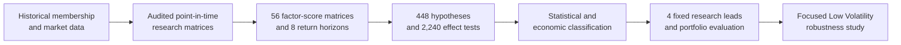
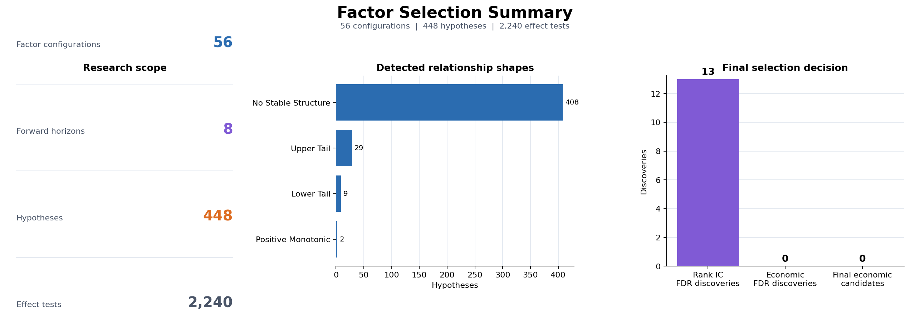
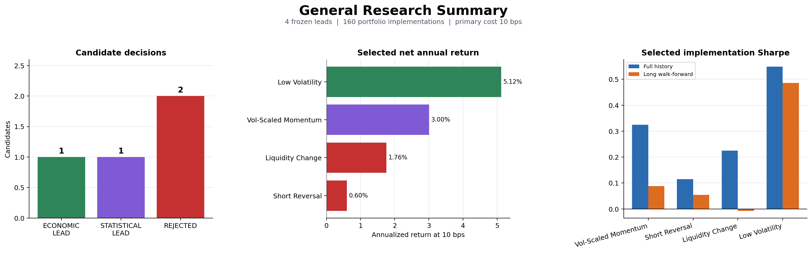
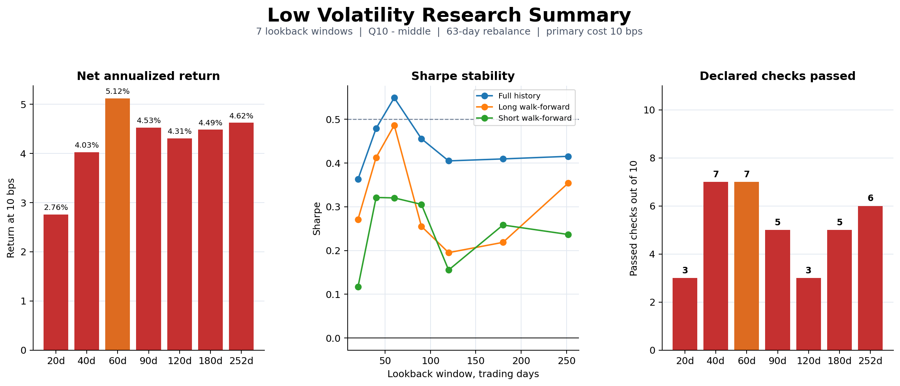

# Cross-Sectional Equity Factor Research

An end-to-end quantitative research study of whether price-, return- and volume-based factors can explain differences in future returns among point-in-time S&P 500 constituents.

**Research scope:** 11 factor families · 56 configurations · 8 horizons · 448 hypotheses.

**Main finding:** statistically significant stock-ranking relationships and one economically interesting Low Volatility lead, but no validated alpha.

[Read the Research Paper](<Research Paper.md>)


## TL;DR

The study evaluates 448 factor-horizon hypotheses through 2,240 statistical and economic effect tests. Benjamini–Hochberg correction is applied separately within each of five effect families, with 448 tests per family.

**Twenty-two Rank-IC tests survive the primary correction.** They belong to six factor families and all use the one-trading-day forward-return horizon. These are related configurations, not 22 independent trading signals. No quantile-return effect survives correction within its own effect family.

Four fixed research leads are examined through portfolio construction, transaction costs, turnover, risk exposures and walk-forward analysis. The strongest economic lead is a 60-day Low Volatility implementation: **5.12% net annualized return, 0.549 Sharpe and −19.52% maximum drawdown** at the declared 10 bps transaction-cost assumption.

The focused Low Volatility study does not establish robust alpha. Its alpha HAC t-statistic is **1.84**, and neighbouring lookbacks do not provide the required support. The result remains an **`ISOLATED_RESULT`**.


## Research Question

Can information in historical prices, returns and trading volume rank stocks by their future relative performance—and can that relationship support an economically useful portfolio?

The project compares eligible stocks with each other on each date. It investigates cross-sectional stock selection rather than forecasting the direction of the entire market.


## Research Pipeline



The five executable stages are:

1. **Data System** — reconstructs historical index membership and prepares audited market-data matrices.
2. **Factor Layer** — creates factor scores and forward-return matrices without selecting winners.
3. **Factor Selection Layer** — evaluates Rank IC, quantile-return shapes, time stability and multiple-testing-adjusted evidence.
4. **General Research** — evaluates four fixed leads through 160 portfolio implementations, including costs and risk diagnostics.
5. **Low Volatility Research** — evaluates seven lookbacks through 280 implementations, judging each lookback against the same fixed portfolio specification.

The four portfolio leads are explicitly exploratory. They are not presented as economic discoveries that passed the complete Selection rules.


## Data and Research Scope

| Component | Scope |
| --- | ---: |
| Market-data period | 2008-01-02 to 2026-08-18 |
| Formal research start | 2010-01-01 |
| Trading dates | 4,686 |
| Historical ticker columns | 900 |
| Observed price coverage during index membership | 98.55% |
| Factor families | 11 |
| Factor configurations | 56 |
| Forward-return horizons | 8 |
| Factor-horizon hypotheses | 448 |
| Statistical and economic effect tests | 2,240 |

Observations from 2008–2009 provide warm-up history for rolling calculations. Factor evaluation begins in 2010.

The prepared dataset combines Yahoo Finance and LSEG historical equity data. Returns use adjusted, total-return-compatible price series. Stored volume is rescaled to preserve the original dollar-volume relationship. Separate price- and volume-quality masks determine which observations can be used.

Historical S&P 500 membership comes from the community-maintained [fja05680/sp500 dataset](https://github.com/fja05680/sp500). The risk-free series is the US three-month Treasury constant-maturity rate, DGS3MO.


## Factor Universe

| Factor family | Configurations | Main idea |
| --- | ---: | --- |
| Momentum | 17 | Previous cumulative return with different formation and skip periods |
| Low Volatility | 7 | Higher scores for lower trailing return volatility |
| Trend | 6 | Price relative to a simple moving average |
| Short-Term Reversal | 3 | Reversal of recent relative performance |
| Residual Momentum | 3 | Momentum after removing the daily equal-weight market return |
| Volatility-Scaled Momentum | 3 | Momentum divided by trailing volatility |
| High Proximity | 3 | Price relative to its rolling high |
| Trend Slope | 4 | Rolling slope of log price |
| Risk-Adjusted Trend | 4 | Trend slope divided by annualized volatility |
| Liquidity Change | 3 | Short-term versus long-term dollar-volume change |
| Price-Volume Confirmation | 3 | Momentum adjusted by liquidity change |

Forward-return horizons: **1, 5, 10, 21, 42, 63, 126 and 252 trading days**.


## Methodology

The research combines:

- point-in-time index membership and separate price- and volume-quality masks;
- one-trading-day signal lag;
- daily cross-sectional factor standardization, Rank IC and ten-quantile return curves;
- monotonic, upper-tail, lower-tail and two-sided-tail pattern classification;
- HAC-adjusted inference for serial dependence and overlapping forward returns;
- monthly and annual direction consistency;
- Benjamini–Hochberg correction at 5% FDR separately within each effect family;
- fixed portfolio research leads, alternative position constructions and rebalance frequencies;
- turnover, transaction costs, beta exposure, calendar-phase and walk-forward analysis;
- neighbouring-parameter and market-regime checks for the strongest economic lead.

The five separately corrected effect families are **Rank IC**, **Q10 − Q1**, **Q10 − middle**, **middle − Q1**, and **both tails − middle**. Each contains 448 factor-horizon tests. Pooled global BH is retained as a comparison. Per-effect FDR control does not imply FDR control across the union of all five families.

Winsorization is available but disabled. Factor signs are not required to be positive: both positive and negative relationships can be informative.


## Factor Selection Results



| Result | Count |
| --- | ---: |
| Hypotheses without a classified stable structure | 408 |
| Descriptive economic patterns | 40 |
| Time-unstable patterns | 16 |
| Patterns rejected by per-effect multiple-testing correction | 24 |
| Rank-IC tests passing per-effect BH | **22** |
| Economic-effect tests passing per-effect BH | **0** |
| Final economic candidates | **0** |

The 40 descriptive patterns comprise 29 upper-tail, nine lower-tail and two positive monotonic patterns. Sixteen fail the temporal-consistency rules; the remaining 24 fail their effect-family correction.

The 22 significant Rank-IC results are distributed across:

| Factor family | Significant tests |
| --- | ---: |
| Momentum | 11 |
| Volatility-Scaled Momentum | 3 |
| Residual Momentum | 2 |
| Trend Slope | 2 |
| Risk-Adjusted Trend | 2 |
| Price-Volume Confirmation | 2 |

All 22 use the one-trading-day horizon. They provide evidence about the cross-sectional ordering of future returns, but do not establish significant quantile-return spreads or net portfolio profitability.

The pooled-global-BH comparison retains 13 Rank-IC results and zero economic effects.


## Portfolio Research Results

Four leads were fixed before portfolio construction. Each is evaluated using the same declared cost and economic decision rules. The table reports the market-neutral implementation with the highest full-history net Sharpe at 10 bps for each lead.

| Research lead | Best evaluated market-neutral return at 10 bps | Sharpe | Decision |
| --- | ---: | ---: | --- |
| Volatility-Scaled Momentum 12m-1m / vol60 | 3.00% | 0.325 | `STATISTICAL_LEAD` |
| Short-Term Reversal 5d | 0.60% | 0.115 | `REJECTED` |
| Liquidity Change 20d/252d | 1.76% | 0.225 | `REJECTED` |
| Low Volatility 60d | **5.12%** | **0.549** | `ECONOMIC_LEAD` |

These are descriptive results from the searched implementation grid. A `STATISTICAL_LEAD` or `ECONOMIC_LEAD` label is not a declaration of validated alpha. The four-lead list is fixed; it is not automatically expanded to include every significant Rank-IC configuration.




## Focused Low Volatility Study

The fixed specification is **Q10 minus the middle quantiles, beta neutralization and rebalancing every 63 trading days**. Because the factor score is negative volatility, Q10 contains the lowest-volatility stocks.

All seven lookbacks—20, 40, 60, 90, 120, 180 and 252 trading days—are assessed against this same specification. The specification was identified in portfolio research; the focused study tests its sensitivity rather than providing independent confirmation. The 60-day result is:

| Metric | Result |
| --- | ---: |
| Net annualized return at 10 bps | **5.12%** |
| Annualized volatility | 10.01% |
| Full-history Sharpe | **0.549** |
| Maximum drawdown | −19.52% |
| Annualized turnover | 8.17x |
| Alpha HAC t-statistic | 1.84 |
| Alpha BH q-value across seven lookbacks | 0.356 |
| Net annualized return at 25 bps | 3.84% |
| Long walk-forward Sharpe | 0.486 |
| Short walk-forward Sharpe | 0.320 |
| Declared checks passed | 7 / 10 |
| Research status | `ISOLATED_RESULT` |



The 60-day implementation passes the declared return, Sharpe, cost, calendar-phase, walk-forward and regime checks. It fails the alpha t-statistic threshold, the seven-lookback alpha FDR test and neighbouring-parameter support. No lookback passes the complete rule set.

The long walk-forward uses the preceding four years to select spread orientation and the following year for evaluation, advancing annually. The short scheme uses 18 months followed by six months, advancing every six months. Portfolio implementations remain fixed. These are post-selection historical diagnostics, not an untouched final test.


## Conclusion and Limitations

The study finds statistically detectable cross-sectional ranking information and one economically interesting Low Volatility implementation. **It does not establish validated alpha.** Statistical predictability, economic return differences and implementable net portfolio returns remain separate findings.

The main limitations are:

- historical index membership comes from a community-maintained source rather than official S&P point-in-time data;
- some historical equity observations and security identities remain unresolved, leaving residual survivorship and data-availability bias;
- point-in-time sector classifications are unavailable, so sector exposure is reported as `NOT_AVAILABLE`;
- fixed transaction costs do not fully model market impact, capacity, borrow fees or short availability;
- the same historical sample influenced discovery and follow-up research, leaving no genuinely untouched final sample;
- the factor universe uses price, return and volume information without fundamental or alternative data.

Further confirmation requires independent data or new observations. The strongest historical implementation is an exploratory research lead, not a production-ready trading strategy.


## Tools

**Python**, pandas, NumPy, SciPy, statsmodels, PyArrow, matplotlib, yfinance and requests. Dependency versions are recorded in [requirements.txt](requirements.txt).


## Quick Start

The project uses Python 3.14 on Windows.

```powershell
git clone https://github.com/Ryhor-Karnatsevich/Cross-Sectional-Equity-Factor-Research.git
cd "Cross-Sectional-Equity-Factor-Research"

py -m venv .venv
.\.venv\Scripts\Activate.ps1
python -m pip install -r requirements.txt
```

Run the complete project:

```powershell
python src\Pipeline\run.py
```

The orchestrator executes all five stages in order and stops if a stage fails. Compatible data, factor, quantile and portfolio caches are reused. Normal Selection runs recompute hypothesis-level statistical summaries from the daily quantile data.

**Data access:** reported results use the prepared Yahoo Finance/LSEG dataset. Large datasets and licensed LSEG inputs are not distributed in Git. A fresh public-data run prepares Yahoo-based inputs; reproducing the reported results requires the corresponding prepared dataset. The complete pipeline does not automatically download or merge LSEG histories.

Run a layer independently:

```powershell
python src\Data_System\pipeline.py
python src\Factors_Layer\pipeline.py
python src\Factor_Selection_Layer\pipeline.py
python src\Research_Layer\pipeline.py
python src\Research_Layer\Low_Volatility\pipeline.py
```

Reapply correction and classification using saved statistics:

```powershell
python src\Factor_Selection_Layer\pipeline.py --correction-only
```

Correction-only mode updates BH values, candidate labels, figures and the Selection report. It skips factor analysis, daily quantile generation, HAC estimation and time-stability calculation. It requires saved results matching the current data and hypothesis scope.

Run implementation checks:

```powershell
python -m unittest discover -s tests -v
```


## Project Structure

```text
src/
├── Data_System/              historical universe, market data and audit
├── Factors_Layer/            factor and forward-return matrices
├── Factor_Selection_Layer/   quantile analysis and hypothesis selection
├── Research_Layer/           portfolio and robustness research
│   └── Low_Volatility/       focused neighbouring-window study
└── Pipeline/
    └── run.py                complete project orchestrator

Data/                         large datasets and caches; excluded from Git
Results/                      reports, figures and compact result tables
tests/                        implementation checks
Research Paper.md             detailed methodology and technical appendix
```


## Main Outputs

| Layer | Report |
| --- | --- |
| Data System | [Data audit](Results/Data_System/data_audit_report.md) |
| Factor Layer | [Factor definitions and configurations](Results/Factors_Layer/factor_layer_report.md) |
| Factor Selection | [Statistical and economic classification](Results/Factor_Selection_Layer/factor_selection_report.md) |
| General Research | [Portfolio research](Results/Research_Layer/General/research_report.md) |
| Low Volatility Research | [Lookback sensitivity and robustness](Results/Research_Layer/Low_Volatility/low_volatility_report.md) |

The [Research Paper](<Research Paper.md>) provides the economic motivation, formulas, experimental design, references and function-level Technical Appendix.

This repository presents financial research and implementation work. It is not investment advice.
