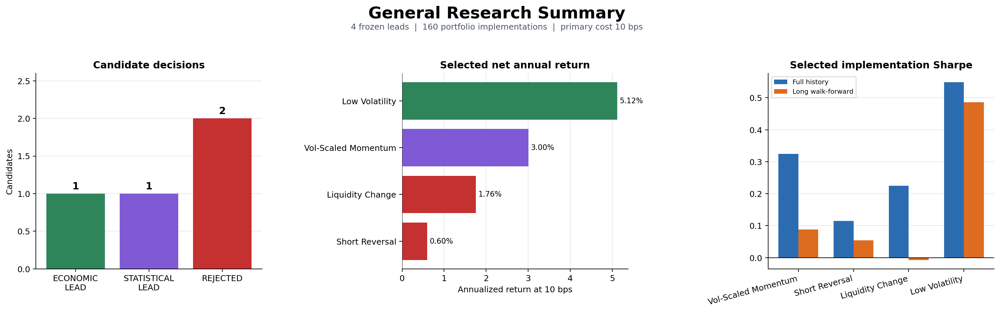
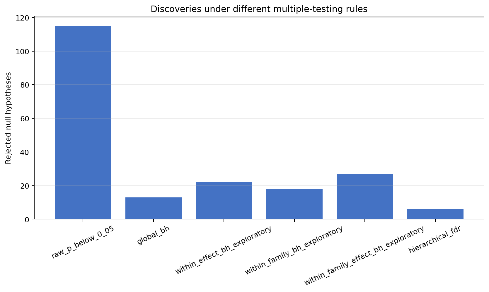
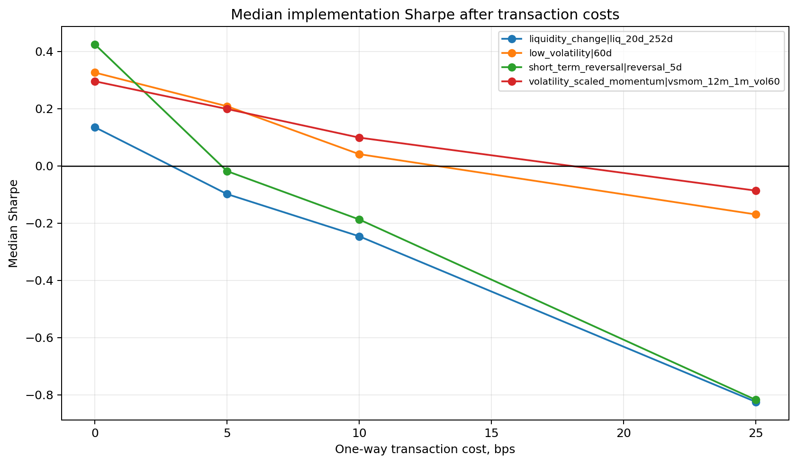
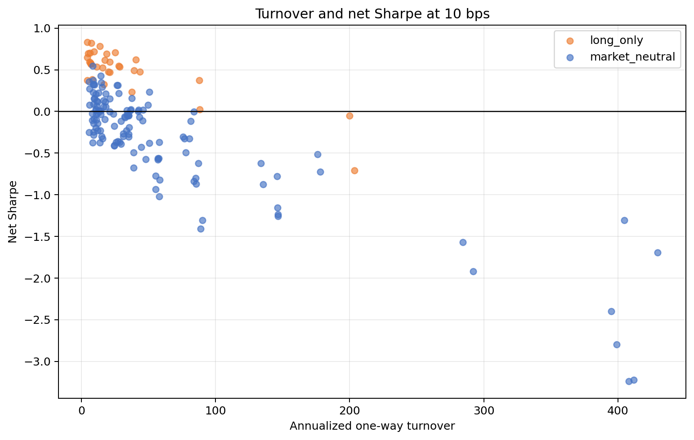
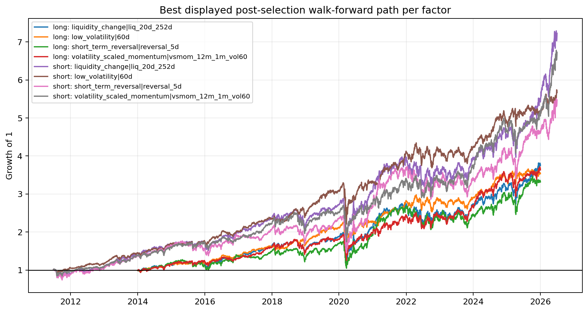
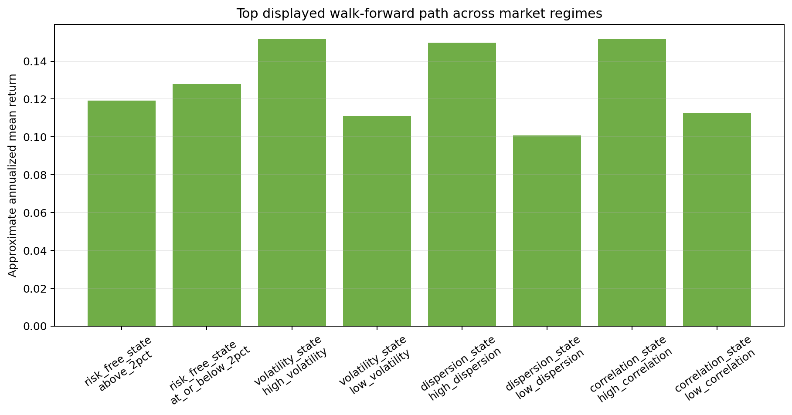
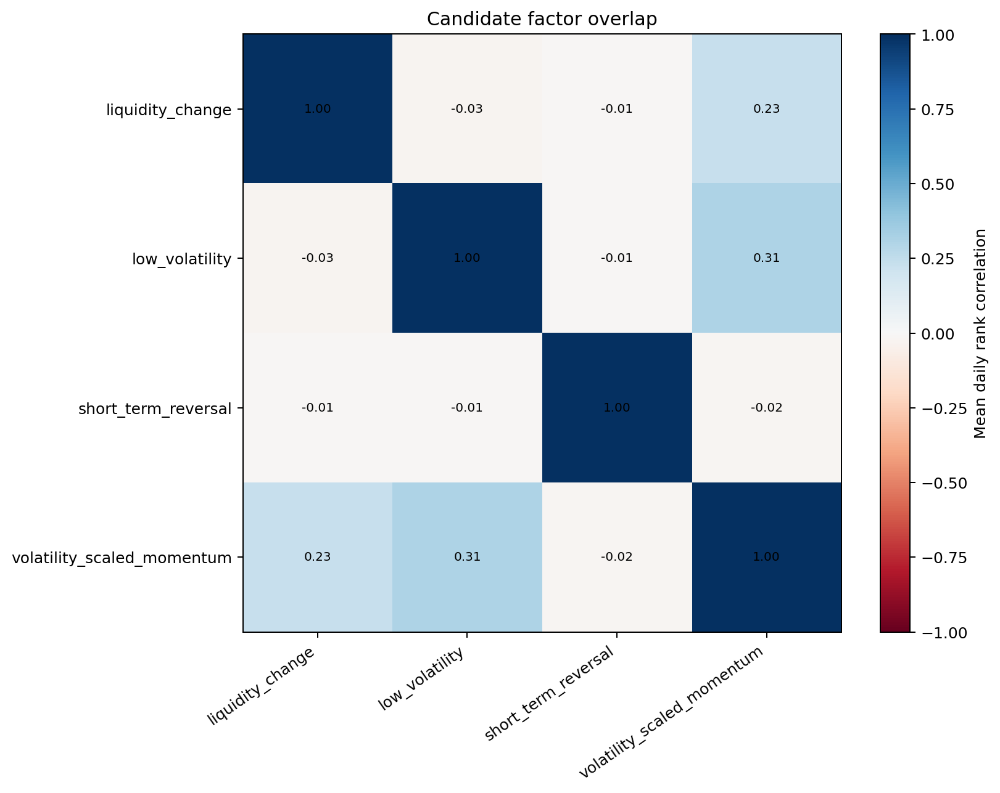

# Research Layer Report

## Scope

- Frozen factor leads: `4`.
- Portfolio implementations: `160`.
- Transaction-cost assumptions: `[0, 5, 10, 25]` bps.
- Primary reporting cost: `10` bps.
- Walk-forward status: post-selection historical simulation, not a genuinely untouched final test.

## Frozen Candidates

| factor_key | selection_horizon | selection_evidence | selection_pattern | selection_status |
| --- | --- | --- | --- | --- |
| volatility_scaled_momentum\|vsmom_12m_1m_vol60 | 1.0000 | global_fdr_rank_signal | no_stable_structure | no_stable_structure |
| short_term_reversal\|reversal_5d | 5.0000 | upper_tail_exploratory_lead | upper_tail | rejected_by_multiple_testing |
| liquidity_change\|liq_20d_252d | 252.0000 | upper_tail_exploratory_lead | upper_tail | rejected_by_multiple_testing |
| low_volatility\|60d | 63.0000 | lower_tail_exploratory_lead | lower_tail | rejected_by_multiple_testing |

## Final Candidate Decisions

The labels apply the declared statistical and economic rules. `VALIDATED_ALPHA` is intentionally unavailable because no untouched final sample remains after candidate discovery.

| factor_key | final_status | best_method | best_rebalance_days | best_net_annualized_return | best_net_sharpe | best_alpha_hac_tstat | best_long_wf_sharpe |
| --- | --- | --- | --- | --- | --- | --- | --- |
| volatility_scaled_momentum\|vsmom_12m_1m_vol60 | STATISTICAL_LEAD | middle_minus_q1 | 63.0000 | 0.0300 | 0.3251 | 1.5052 | 0.0878 |
| short_term_reversal\|reversal_5d | REJECTED | middle_minus_q1 | 63.0000 | 0.0060 | 0.1154 | 0.3931 | 0.0546 |
| liquidity_change\|liq_20d_252d | REJECTED | q10_minus_q1 | 63.0000 | 0.0176 | 0.2254 | 0.8949 | -0.0072 |
| low_volatility\|60d | ECONOMIC_LEAD | q10_minus_middle | 63.0000 | 0.0512 | 0.5490 | 1.8376 | 0.4862 |

## Benchmarks

| benchmark | annualized_return | annualized_volatility | sharpe | maximum_drawdown |
| --- | --- | --- | --- | --- |
| equal_weight_market | 0.1361 | 0.1821 | 0.7107 | -0.4002 |
| risk_free | 0.0150 | 0.0012 |  | 0.0000 |

## Multiple Testing Sensitivity

Global FDR remains the original confirmatory result. Within-group values are reported as sensitivity diagnostics and do not replace it after seeing the data.

| method | rejections | economic_rejections | ic_rejections | interpretation |
| --- | --- | --- | --- | --- |
| raw_p_below_0_05 | 115.0000 | 58.0000 | 57.0000 | exploratory |
| global_bh | 13.0000 | 0.0000 | 13.0000 | confirmatory |
| within_effect_bh_exploratory | 22.0000 | 0.0000 | 22.0000 | exploratory |
| within_family_bh_exploratory | 18.0000 | 0.0000 | 18.0000 | exploratory |
| within_family_effect_bh_exploratory | 27.0000 | 0.0000 | 27.0000 | exploratory |
| hierarchical_fdr | 6.0000 | 0.0000 | 6.0000 | structured_sensitivity |

## Candidate Factor Overlap

Daily cross-sectional rank correlation shows whether two candidate formulas mostly encode the same stock ordering.

| factor_left | factor_right | mean_daily_rank_correlation | mean_absolute_daily_rank_correlation | high_absolute_overlap_rate |
| --- | --- | --- | --- | --- |
| volatility_scaled_momentum\|vsmom_12m_1m_vol60 | low_volatility\|60d | 0.3086 | 0.3193 | 0.0000 |
| volatility_scaled_momentum\|vsmom_12m_1m_vol60 | liquidity_change\|liq_20d_252d | 0.2336 | 0.2341 | 0.0000 |
| short_term_reversal\|reversal_5d | low_volatility\|60d | -0.0086 | 0.2171 | 0.0000 |
| volatility_scaled_momentum\|vsmom_12m_1m_vol60 | short_term_reversal\|reversal_5d | -0.0183 | 0.1740 | 0.0000 |
| liquidity_change\|liq_20d_252d | low_volatility\|60d | -0.0273 | 0.1124 | 0.0000 |
| short_term_reversal\|reversal_5d | liquidity_change\|liq_20d_252d | -0.0088 | 0.0826 | 0.0000 |

## Full-History Portfolio Implementations

These results are descriptive because both candidates and implementations are visible on the same historical sample.

| factor_key | method | beta_neutral | rebalance_days | annualized_return | sharpe | maximum_drawdown | annualized_turnover | alpha_hac_tstat |
| --- | --- | --- | --- | --- | --- | --- | --- | --- |
| low_volatility\|60d | long_q10 | False | 63.0000 | 0.1223 | 0.8335 | -0.3299 | 4.1992 | 1.7784 |
| low_volatility\|60d | long_q10 | False | 21.0000 | 0.1194 | 0.8223 | -0.3254 | 7.2680 | 1.6869 |
| low_volatility\|60d | long_q10 | False | 5.0000 | 0.1119 | 0.7818 | -0.3004 | 13.6207 | 1.4567 |
| volatility_scaled_momentum\|vsmom_12m_1m_vol60 | long_q10 | False | 21.0000 | 0.1359 | 0.7180 | -0.3567 | 9.1501 | 1.0291 |
| low_volatility\|60d | long_q10 | False | 1.0000 | 0.1012 | 0.7067 | -0.3004 | 25.2220 | 0.9737 |
| liquidity_change\|liq_20d_252d | long_q10 | False | 63.0000 | 0.1375 | 0.7003 | -0.3908 | 6.4130 | 0.4641 |
| volatility_scaled_momentum\|vsmom_12m_1m_vol60 | long_q10 | False | 63.0000 | 0.1319 | 0.6958 | -0.3537 | 4.9128 | 0.7815 |
| volatility_scaled_momentum\|vsmom_12m_1m_vol60 | long_q10 | False | 5.0000 | 0.1309 | 0.6944 | -0.3597 | 18.6415 | 0.8709 |
| low_volatility\|60d | long_q1 | False | 63.0000 | 0.1705 | 0.6470 | -0.4709 | 4.2334 | 0.1516 |
| volatility_scaled_momentum\|vsmom_12m_1m_vol60 | long_q10 | False | 1.0000 | 0.1167 | 0.6218 | -0.3671 | 40.6352 | 0.3235 |
| liquidity_change\|liq_20d_252d | long_q10 | False | 21.0000 | 0.1213 | 0.6170 | -0.4062 | 17.3558 | -0.5083 |
| liquidity_change\|liq_20d_252d | long_q1 | False | 63.0000 | 0.1221 | 0.5973 | -0.4243 | 5.8163 | -1.2248 |
| short_term_reversal\|reversal_5d | long_q10 | False | 21.0000 | 0.1319 | 0.5938 | -0.4761 | 20.9113 | -0.8569 |
| low_volatility\|60d | long_q1 | False | 21.0000 | 0.1561 | 0.5869 | -0.5128 | 6.6888 | -0.4419 |
| short_term_reversal\|reversal_5d | long_q10 | False | 63.0000 | 0.1214 | 0.5711 | -0.4599 | 6.9741 | -1.3255 |

## Walk-Forward Behaviour

Each implementation is kept fixed. Only the sign of a market-neutral spread is chosen inside either the preceding 18-month or four-year training window and then applied to the following six- or twelve-month OOS period. No implementation winner is silently removed from the output.

| factor_key | method | beta_neutral | rebalance_days | complete_oos_periods | positive_oos_period_rate | stitched_oos_annualized_return | stitched_oos_sharpe | orientation_changes |
| --- | --- | --- | --- | --- | --- | --- | --- | --- |
| low_volatility\|60d | long_q10 | False | 63.0000 | 30.0000 | 0.9333 | 0.1229 | 0.8151 | 0.0000 |
| low_volatility\|60d | long_q10 | False | 21.0000 | 30.0000 | 0.9000 | 0.1192 | 0.8008 | 0.0000 |
| low_volatility\|60d | long_q10 | False | 5.0000 | 30.0000 | 0.8333 | 0.1117 | 0.7615 | 0.0000 |
| liquidity_change\|liq_20d_252d | long_q10 | False | 63.0000 | 30.0000 | 0.8667 | 0.1413 | 0.7148 | 0.0000 |
| volatility_scaled_momentum\|vsmom_12m_1m_vol60 | long_q10 | False | 63.0000 | 30.0000 | 0.8333 | 0.1358 | 0.7116 | 0.0000 |
| low_volatility\|60d | long_q10 | False | 63.0000 | 12.0000 | 1.0000 | 0.1112 | 0.6999 | 0.0000 |
| volatility_scaled_momentum\|vsmom_12m_1m_vol60 | long_q10 | False | 21.0000 | 30.0000 | 0.8333 | 0.1330 | 0.6985 | 0.0000 |
| low_volatility\|60d | long_q10 | False | 1.0000 | 30.0000 | 0.8000 | 0.1006 | 0.6842 | 0.0000 |
| low_volatility\|60d | long_q10 | False | 21.0000 | 12.0000 | 1.0000 | 0.1069 | 0.6814 | 0.0000 |
| volatility_scaled_momentum\|vsmom_12m_1m_vol60 | long_q10 | False | 5.0000 | 30.0000 | 0.8333 | 0.1281 | 0.6758 | 0.0000 |
| low_volatility\|60d | long_q1 | False | 63.0000 | 30.0000 | 0.8000 | 0.1739 | 0.6504 | 0.0000 |
| low_volatility\|60d | long_q10 | False | 5.0000 | 12.0000 | 1.0000 | 0.0992 | 0.6403 | 0.0000 |
| liquidity_change\|liq_20d_252d | long_q10 | False | 21.0000 | 30.0000 | 0.8667 | 0.1259 | 0.6366 | 0.0000 |
| volatility_scaled_momentum\|vsmom_12m_1m_vol60 | long_q10 | False | 1.0000 | 30.0000 | 0.8333 | 0.1129 | 0.5979 | 0.0000 |
| liquidity_change\|liq_20d_252d | long_q10 | False | 63.0000 | 12.0000 | 0.8333 | 0.1166 | 0.5902 | 0.0000 |

## Risk and Data Diagnostics

- Sector exposure status: `NOT_AVAILABLE` — Data System has no point-in-time sector_history.csv. Historical sector exposure was not estimated.
- Missing returns held by a portfolio are reported as unpriced weight; they are never silently presented as verified zero returns.
- Beta-neutralization uses trailing 252-day betas shifted by one day.
- Long-only Sharpe is calculated over the risk-free rate. Market-neutral Sharpe uses the self-financing spread return convention.

| factor_key | method | beta_neutral | rebalance_days | average_estimated_beta | maximum_absolute_estimated_beta | average_gross_exposure | average_net_exposure | maximum_position_weight | maximum_unpriced_weight |
| --- | --- | --- | --- | --- | --- | --- | --- | --- | --- |
| low_volatility\|60d | q10_minus_q1 | False | 63.0000 | -0.9025 | 4.6539 | 2.0496 | -0.0130 | 0.1239 | 0.0329 |
| low_volatility\|60d | middle_minus_q1 | False | 63.0000 | -0.4539 | 2.4666 | 2.0436 | 0.0001 | 0.0943 | 0.0235 |
| low_volatility\|60d | q10_minus_q1 | False | 21.0000 | -0.8584 | 1.9580 | 2.0085 | -0.0020 | 0.0528 | 0.0233 |
| short_term_reversal\|reversal_5d | long_q1 | False | 1.0000 | 1.0979 | 1.9117 | 1.0000 | 1.0000 | 0.0208 | 0.0000 |
| short_term_reversal\|reversal_5d | long_q10 | False | 1.0000 | 1.0893 | 1.8471 | 1.0000 | 1.0000 | 0.0204 | 0.0000 |
| volatility_scaled_momentum\|vsmom_12m_1m_vol60 | q10_minus_q1 | False | 63.0000 | -0.2052 | 1.8273 | 2.0020 | 0.0033 | 0.0771 | 0.0220 |
| short_term_reversal\|reversal_5d | long_q1 | False | 5.0000 | 1.0955 | 1.8101 | 0.9991 | 0.9991 | 0.0323 | 0.0135 |
| low_volatility\|60d | long_q1 | False | 63.0000 | 1.4000 | 1.7966 | 0.9787 | 0.9787 | 0.0411 | 0.0218 |
| low_volatility\|60d | long_q1 | False | 1.0000 | 1.4236 | 1.7940 | 1.0000 | 1.0000 | 0.0208 | 0.0000 |
| low_volatility\|60d | long_q1 | False | 21.0000 | 1.4156 | 1.7880 | 0.9924 | 0.9924 | 0.0414 | 0.0206 |

## Calendar-Phase Stability

| path_key | phase_count | phase_sharpe_mean | phase_sharpe_min | phase_sharpe_max | phase_sharpe_std |
| --- | --- | --- | --- | --- | --- |
| low_volatility\|60d\|long_q10\|unconstrained_beta\|r63\|ensemble | 3.0000 | 0.9394 | 0.9213 | 0.9613 | 0.0166 |
| low_volatility\|60d\|long_q10\|unconstrained_beta\|r21\|ensemble | 3.0000 | 0.9341 | 0.9246 | 0.9482 | 0.0102 |
| low_volatility\|60d\|long_q10\|unconstrained_beta\|r5\|ensemble | 3.0000 | 0.8975 | 0.8498 | 0.9234 | 0.0338 |
| low_volatility\|60d\|long_q10\|unconstrained_beta\|r1\|ensemble | 1.0000 | 0.8242 | 0.8242 | 0.8242 | 0.0000 |
| volatility_scaled_momentum\|vsmom_12m_1m_vol60\|long_q10\|unconstrained_beta\|r21\|ensemble | 3.0000 | 0.7968 | 0.7690 | 0.8344 | 0.0276 |
| volatility_scaled_momentum\|vsmom_12m_1m_vol60\|long_q10\|unconstrained_beta\|r5\|ensemble | 3.0000 | 0.7759 | 0.7355 | 0.8050 | 0.0295 |
| volatility_scaled_momentum\|vsmom_12m_1m_vol60\|long_q10\|unconstrained_beta\|r63\|ensemble | 3.0000 | 0.7704 | 0.7314 | 0.8460 | 0.0535 |
| liquidity_change\|liq_20d_252d\|long_q10\|unconstrained_beta\|r63\|ensemble | 3.0000 | 0.7700 | 0.6818 | 0.8242 | 0.0629 |
| volatility_scaled_momentum\|vsmom_12m_1m_vol60\|long_q10\|unconstrained_beta\|r1\|ensemble | 1.0000 | 0.7047 | 0.7047 | 0.7047 | 0.0000 |
| low_volatility\|60d\|long_q1\|unconstrained_beta\|r63\|ensemble | 3.0000 | 0.6951 | 0.6803 | 0.7051 | 0.0107 |

## Interpretation Boundary

- A strong full-history path is not final evidence because the candidate shortlist was obtained from the same complete history.
- Hierarchical and within-family FDR are sensitivity checks, not permission to ignore the global FDR result.
- A candidate requires coherent walk-forward returns, tolerable turnover and costs, controlled risk exposure, and no dependence on one market regime.
- Remaining Yahoo historical-data limitations continue to apply.

## Figures

### Multiple Testing Comparison

### Transaction Cost Sensitivity

### Turnover Vs Sharpe

### Walk Forward Paths

### Regime Comparison

### Factor Overlap

