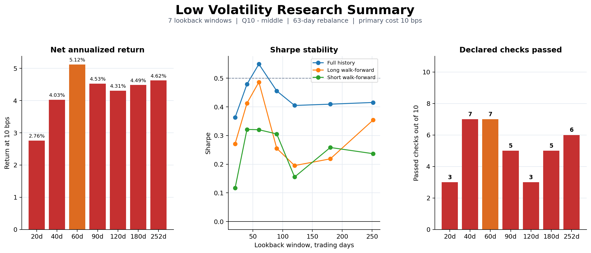
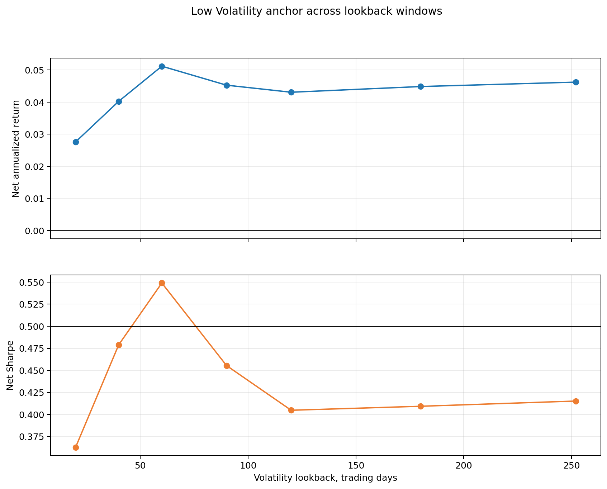
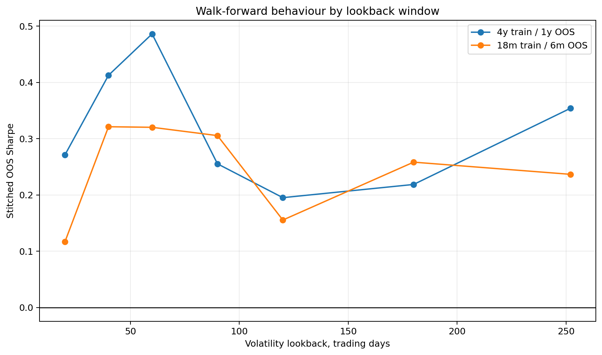
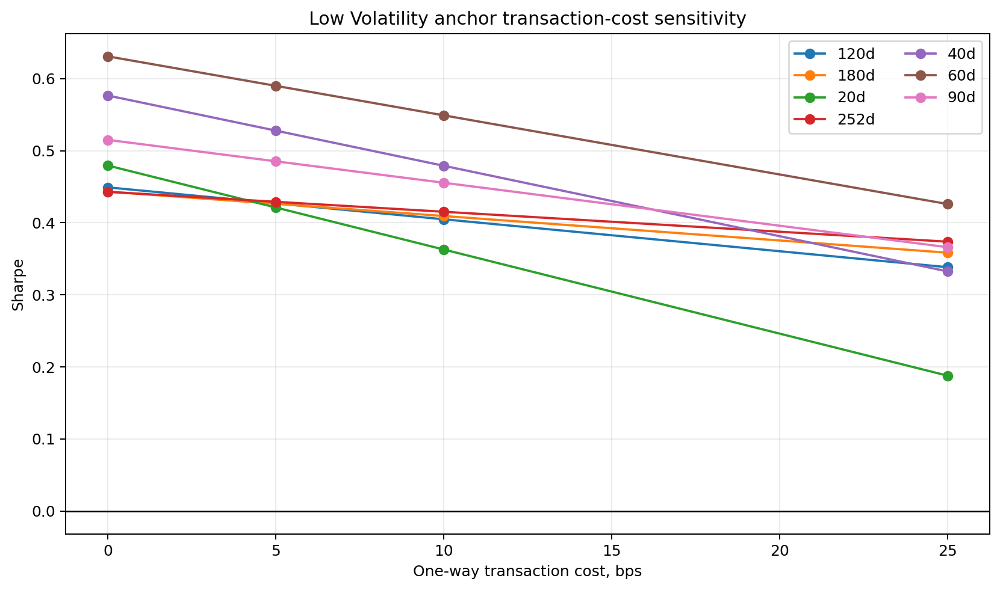
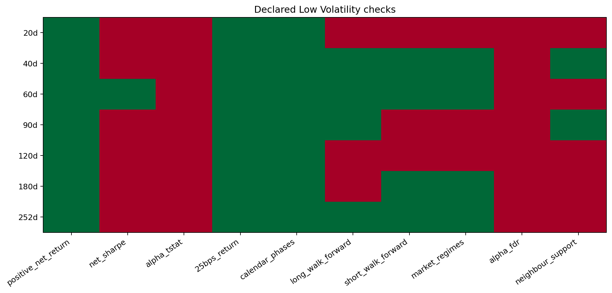

# Low Volatility Deep Dive

## Scope

- Tested lookbacks: `[20, 40, 60, 90, 120, 180, 252]` trading days.
- Fixed anchor: `q10_minus_middle`, beta-neutral, rebalance every `63` days.
- Primary cost: `10` bps.
- The complete portfolio grid is retained for description, but every lookback is judged using the same anchor implementation.
- The anchor was discovered after viewing Layer 4, so this is sensitivity research, not a new untouched test.
- Because the factor is negative volatility, Q10 contains the lowest-volatility stocks.

## Selection-Layer Boundary

The 63-day Selection result described a lower-tail pattern, while the Layer 4 anchor uses the opposite low-volatility Q10 side. This direction was found post-selection and is therefore labelled explicitly rather than presented as prior confirmation.

| factor_key | window | selection_pattern | selection_status |
| --- | --- | --- | --- |
| low_volatility\|20d | 20.0000 | no_stable_structure | no_stable_structure |
| low_volatility\|40d | 40.0000 | lower_tail | time_unstable_pattern |
| low_volatility\|60d | 60.0000 | lower_tail | rejected_by_multiple_testing |
| low_volatility\|90d | 90.0000 | lower_tail | time_unstable_pattern |
| low_volatility\|120d | 120.0000 | no_stable_structure | no_stable_structure |
| low_volatility\|180d | 180.0000 | no_stable_structure | no_stable_structure |
| low_volatility\|252d | 252.0000 | no_stable_structure | no_stable_structure |

## Declared Rules

- Net Sharpe at 10 bps >= `0.5`.
- Alpha HAC t-stat at 10 bps >= `1.96`.
- The same alpha result must survive Benjamini-Hochberg FDR across all seven anchor windows.
- Positive return at both 10 and 25 bps.
- Every tested calendar phase has positive annualized return.
- The long walk-forward anchor has positive return in every reported market-regime state.
- Long walk-forward Sharpe >= `0.25` and positive-period rate >= `0.67`.
- Short walk-forward Sharpe > `0.0` and positive-period rate >= `0.55`.
- At least one adjacent declared lookback must pass the core economic checks.

## Window Results

| window | research_status | net_annualized_return_10bps | net_sharpe_10bps | alpha_hac_tstat_10bps | alpha_bh_q_value_10bps | regression_beta_10bps | net_annualized_return_25bps | maximum_drawdown_10bps | annualized_turnover | long_wf_sharpe | short_wf_sharpe | minimum_regime_annualized_return | neighbour_support_count | passed_declared_checks |
| --- | --- | --- | --- | --- | --- | --- | --- | --- | --- | --- | --- | --- | --- | --- |
| 20.0000 | NOT_SUPPORTED | 0.0276 | 0.3628 | 1.1482 | 0.3744 | 0.0382 | 0.0124 | -0.2197 | 9.8927 | 0.2711 | 0.1167 | -0.0205 | 0.0000 | 3.0000 |
| 40.0000 | NOT_SUPPORTED | 0.0403 | 0.4790 | 1.6372 | 0.3556 | 0.0379 | 0.0265 | -0.1716 | 8.8579 | 0.4127 | 0.3212 | 0.0074 | 1.0000 | 7.0000 |
| 60.0000 | ISOLATED_RESULT | 0.0512 | 0.5490 | 1.8376 | 0.3556 | 0.0559 | 0.0384 | -0.1952 | 8.1693 | 0.4862 | 0.3202 | 0.0191 | 0.0000 | 7.0000 |
| 90.0000 | NOT_SUPPORTED | 0.0453 | 0.4555 | 1.2782 | 0.3744 | 0.0954 | 0.0350 | -0.2496 | 6.5783 | 0.2553 | 0.3054 | -0.0087 | 1.0000 | 5.0000 |
| 120.0000 | NOT_SUPPORTED | 0.0431 | 0.4048 | 0.9166 | 0.3744 | 0.1409 | 0.0346 | -0.3214 | 5.4379 | 0.1952 | 0.1554 | -0.0087 | 0.0000 | 3.0000 |
| 180.0000 | NOT_SUPPORTED | 0.0449 | 0.4093 | 0.8968 | 0.3744 | 0.1554 | 0.0381 | -0.3233 | 4.2965 | 0.2186 | 0.2583 | 0.0028 | 0.0000 | 5.0000 |
| 252.0000 | NOT_SUPPORTED | 0.0462 | 0.4152 | 0.8883 | 0.3744 | 0.1678 | 0.0407 | -0.3261 | 3.5632 | 0.3540 | 0.2366 | 0.0039 | 0.0000 | 6.0000 |

## Benchmarks

| benchmark | annualized_return | annualized_volatility | sharpe | maximum_drawdown |
| --- | --- | --- | --- | --- |
| equal_weight_market | 0.1361 | 0.1821 | 0.7107 | -0.4002 |
| risk_free | 0.0150 | 0.0012 |  | 0.0000 |

## Strongest Full-Grid Implementations

These are descriptive maxima from the searched implementation grid and are not used as independent confirmation.

| factor_key | method | beta_neutral | rebalance_days | annualized_return | sharpe | alpha_hac_tstat | annualized_turnover | maximum_drawdown |
| --- | --- | --- | --- | --- | --- | --- | --- | --- |
| low_volatility\|60d | q10_minus_middle | True | 63.0000 | 0.0512 | 0.5490 | 1.8376 | 8.1693 | -0.1952 |
| low_volatility\|90d | q10_minus_middle | True | 5.0000 | 0.0479 | 0.5035 | 1.9929 | 19.5283 | -0.1895 |
| low_volatility\|40d | q10_minus_middle | True | 63.0000 | 0.0403 | 0.4790 | 1.6372 | 8.8579 | -0.1716 |
| low_volatility\|90d | q10_minus_middle | True | 21.0000 | 0.0459 | 0.4775 | 1.6538 | 11.0170 | -0.2061 |
| low_volatility\|90d | q10_minus_middle | True | 63.0000 | 0.0453 | 0.4555 | 1.2782 | 6.5783 | -0.2496 |
| low_volatility\|180d | q10_minus_middle | True | 5.0000 | 0.0458 | 0.4520 | 1.5697 | 12.0001 | -0.2029 |
| low_volatility\|252d | q10_minus_middle | True | 5.0000 | 0.0442 | 0.4347 | 1.4510 | 9.3731 | -0.2098 |
| low_volatility\|120d | q10_minus_middle | True | 5.0000 | 0.0420 | 0.4332 | 1.6113 | 15.8824 | -0.2148 |
| low_volatility\|60d | q10_minus_middle | True | 21.0000 | 0.0386 | 0.4270 | 1.5202 | 14.1903 | -0.2128 |
| low_volatility\|252d | q10_minus_middle | True | 21.0000 | 0.0443 | 0.4236 | 1.1732 | 5.4163 | -0.2712 |
| low_volatility\|120d | q10_minus_middle | True | 21.0000 | 0.0417 | 0.4234 | 1.3453 | 8.8104 | -0.2734 |
| low_volatility\|252d | q10_minus_middle | True | 63.0000 | 0.0462 | 0.4152 | 0.8883 | 3.5632 | -0.3261 |
| low_volatility\|180d | q10_minus_middle | True | 63.0000 | 0.0449 | 0.4093 | 0.8968 | 4.2965 | -0.3233 |
| low_volatility\|120d | q10_minus_middle | True | 63.0000 | 0.0431 | 0.4048 | 0.9166 | 5.4379 | -0.3214 |
| low_volatility\|180d | q10_minus_middle | True | 21.0000 | 0.0416 | 0.4046 | 1.1399 | 6.7699 | -0.2895 |

## Conclusion

No Low Volatility window formed a robust neighbouring plateau under the declared rules.

## Limitations

- Sector exposure status: `NOT_AVAILABLE` — Data System has no point-in-time sector_history.csv. Historical sector exposure was not estimated.
- Candidate and anchor selection used the same historical dataset.
- Yahoo historical availability and residual survivorship bias remain.
- No result from this report is labelled `VALIDATED_ALPHA`.

## Figures

### Window Sensitivity

### Walk Forward Windows

### Cost Sensitivity

### Declared Checks

